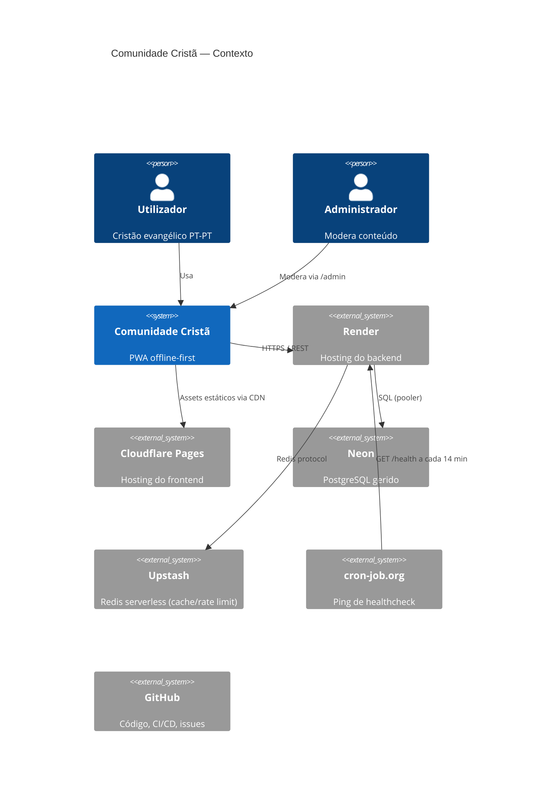
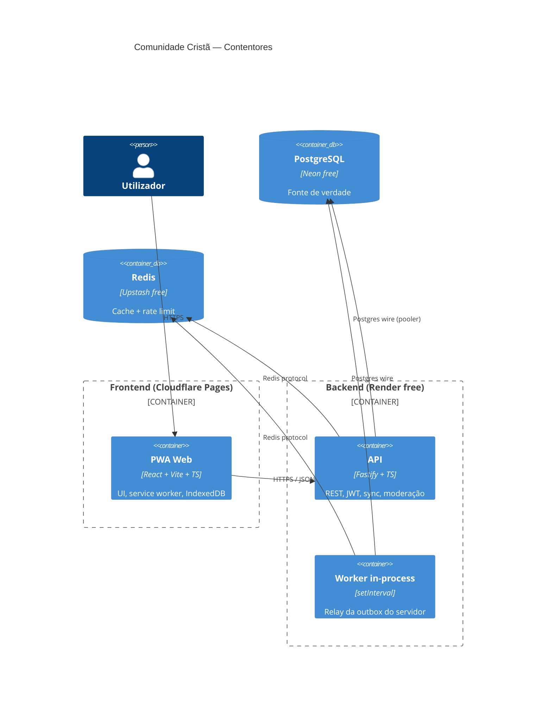
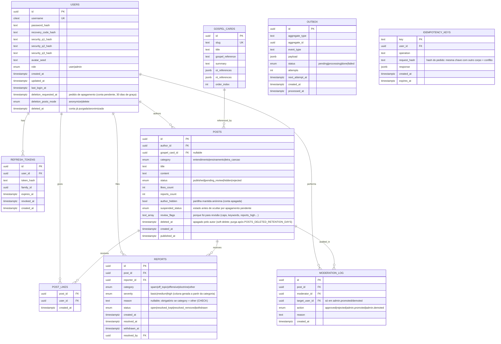
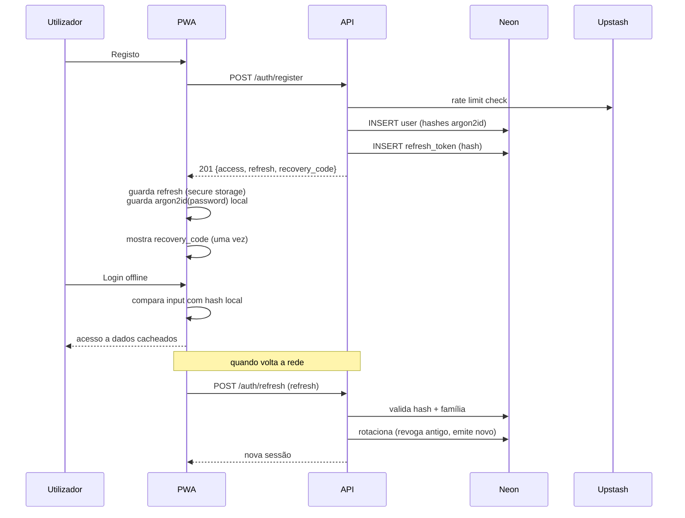
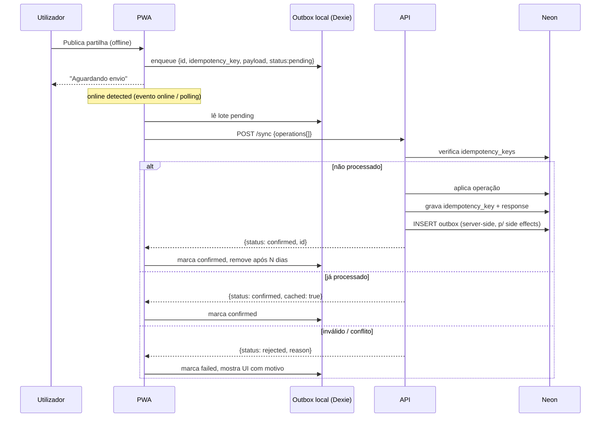
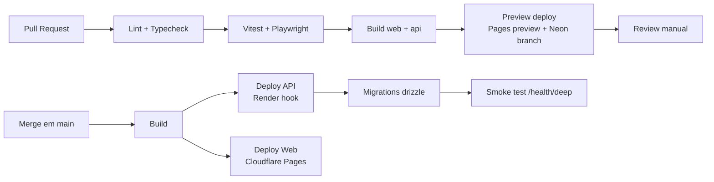

# Documento 2 — Arquitectura

**Versão**: 1.0
**Base**: Briefing 1.0

---

## 1. Contexto (C4 Nível 1)



## 2. Contentores (C4 Nível 2)



## 3. Stack decidida

| Camada                | Escolha                                                           |
| --------------------- | ----------------------------------------------------------------- |
| Frontend              | React 18 + Vite + TypeScript; PWA via `vite-plugin-pwa` (Workbox) |
| Estado / dados locais | TanStack Query + Dexie (IndexedDB)                                |
| UI                    | Tailwind CSS + Radix primitives + Lucide icons                    |
| Backend               | Node 20 + Fastify + TypeScript                                    |
| Base de dados         | PostgreSQL (Neon free) via `pg` + drizzle-orm                     |
| Cache                 | Upstash Redis (`@upstash/redis`)                                  |
| Autenticação          | JWT (EdDSA) + refresh rotativo + argon2id (`@node-rs/argon2`)     |
| Validação             | Zod (partilhado via `packages/shared`)                            |
| Testes                | Vitest (unit) + Playwright (E2E)                                  |
| CI/CD                 | GitHub Actions                                                    |
| Infra local           | Docker Compose (Postgres + Redis)                                 |
| Monorepo              | pnpm workspaces                                                   |
| Licença               | AGPL-3.0                                                          |

### Estrutura do repositório

```
/
├── apps/
│   ├── web/                 # React + Vite + PWA (inclui /admin lazy)
│   └── api/                 # Fastify + TS
├── packages/
│   ├── shared/              # Tipos, schemas Zod, constantes
│   └── config/              # ESLint, Prettier, tsconfig base
├── docs/
│   ├── briefing.md
│   ├── architecture.md
│   ├── runbook.md
│   └── adr/
├── .github/workflows/
├── docker-compose.yml
├── pnpm-workspace.yaml
├── LICENSE
├── CONTRIBUTING.md
├── CODE_OF_CONDUCT.md
└── SECURITY.md
```

O admin vive na mesma app (`apps/web`), em rotas `/admin/*`, carregadas por `React.lazy` e protegidas por role. Reduz superfície operacional no MVP; pode ser separado em `apps/admin` mais tarde se necessário.

## 4. Decisões de arquitectura (ADRs)

Cada decisão tem o seu ficheiro em [`adr/`](adr/README.md) (um ADR por ficheiro: o histórico fica no git e as ligações não partem quando o texto cresce).

| ADR                       | Decisão                                                     |
| ------------------------- | ----------------------------------------------------------- |
| [ADR-001](adr/ADR-001.md) | PWA em vez de app nativa                                    |
| [ADR-002](adr/ADR-002.md) | Monorepo com pnpm workspaces                                |
| [ADR-003](adr/ADR-003.md) | Neon em vez de Supabase                                     |
| [ADR-004](adr/ADR-004.md) | Upstash Redis apenas para cache e rate limit                |
| [ADR-005](adr/ADR-005.md) | Outbox table em Postgres + worker in-process                |
| [ADR-006](adr/ADR-006.md) | Autenticação: JWT EdDSA + refresh rotativo + argon2id       |
| [ADR-007](adr/ADR-007.md) | Offline-first com outbox local + idempotency keys           |
| [ADR-008](adr/ADR-008.md) | Conteúdo bíblico apenas por referência                      |
| [ADR-009](adr/ADR-009.md) | Avatar gerado, sem upload                                   |
| [ADR-010](adr/ADR-010.md) | Admin na mesma app, role `admin`                            |
| [ADR-011](adr/ADR-011.md) | Recuperação de conta: código imediato, perguntas com atraso |
| [ADR-012](adr/ADR-012.md) | Apagamento de conta: período de graça de 30 dias            |
| [ADR-013](adr/ADR-013.md) | Filtro anti-spam no conteúdo                                |
| [ADR-014](adr/ADR-014.md) | Severidade de denúncias                                     |
| [ADR-015](adr/ADR-015.md) | Admin: criação e promoção só por CLI, mesmo login           |

## 5. Modelo de dados



**Notas**

- UUID v7 em todas as PKs (ordenação temporal sem colisões).
- `citext` para `username` (unicidade case-insensitive).
- Índices: `posts(status, created_at)`, `posts(gospel_card_id, status)`, `posts(author_id, created_at)`, `posts(category, status)`, `post_likes(user_id)`, `reports(post_id, status)`, `reports(post_id, category, status)`, `reports(reporter_id, status)`, `outbox(status, next_attempt_at)`. `reports` tem unicidade `(post_id, reporter_id)`: uma denúncia por utilizador e post, em qualquer estado.
- `outbox` e `idempotency_keys` têm TTL — purga periódica pelo worker (ex.: > 7 dias).
- Purga de conta: `posts.author_id` → NULL (partilha anónima, "[removido]"); `moderation_log.post_id` e `moderator_id` → NULL (a auditoria nunca se perde); `post_likes`, `reports`, `refresh_tokens` e `idempotency_keys` apagam-se em cascata. `idempotency_keys` tem PK `(user_id, key)`: a chave vem do cliente e só é única por utilizador.
- Outbox: `claimBatch` empurra `next_attempt_at` para o futuro (5 min) ao reservar; um evento preso em `processing` só volta a ser reclamável depois desse prazo.
- Apagamento de conta (ADR-012): `users.deletion_requested_at` marca a conta pendente (e `deletion_posts_mode` a escolha do utilizador); `users.deleted_at` marca a conta já purgada. A purga corre no job de manutenção. Partilhas: `author_hidden` (modo anonimizar) ou `suspended_status` (modo apagar, ocultas até à purga). Uma conta pendente não escreve (os serviços consultam a base de dados em cada escrita).
- Posts apagados pelo autor (soft delete, `posts.deleted_at`): saem de todas as leituras; a linha, com likes e denúncias, fica como evidência até à purga (`POSTS_DELETED_RETENTION_DAYS`, 30 por omissão).
- Denúncias (ADR-014): `reports.severity` é uma coluna **gerada** a partir da categoria. Retirar uma denúncia passa-a a `withdrawn` (a linha fica; deixa de contar). `reports_other_requires_reason` garante o motivo em `other`.
- `posts.review_flags` guarda os códigos que levaram a `pending_review` (sinais do filtro, ADR-013, ou `reports_<gravidade>`, ADR-014).
- Idempotência (`post.create`): a chave é reservada **antes** de criar o post (`INSERT … ON CONFLICT DO UPDATE … WHERE expires_at <= now()`), com `request_hash`; repetir a chave devolve a resposta guardada, e o mesmo valor com outro corpo é `idempotency_key_conflict`.
- `pending_password_resets` (1 por utilizador) e `used_recovery_sessions` (jti, purgado ao expirar) suportam a recuperação (ADR-011).

## 6. Contratos de API (resumo)

Base: `/api/v1`. Todas as rotas autenticadas usam `Authorization: Bearer <access>`. Respostas e pedidos validados com Zod (`packages/shared`).

### Autenticação

| Método | Rota                   | Descrição                                                                    |
| ------ | ---------------------- | ---------------------------------------------------------------------------- |
| POST   | `/auth/register`       | Cria conta. Devolve tokens + `recovery_code` (única vez).                    |
| POST   | `/auth/login`          | Devolve tokens. Rate-limited por IP + username.                              |
| POST   | `/auth/refresh`        | Rotativo. Deteta reuso → revoga família.                                     |
| POST   | `/auth/logout`         | Revoga o refresh atual.                                                      |
| GET    | `/auth/me`             | Dados do utilizador autenticado.                                             |
| POST   | `/auth/recover/verify` | Valida código de recuperação **ou** 3 perguntas. Devolve `recovery_session`. |
| POST   | `/auth/recover/reset`  | Usa `recovery_session` para definir nova palavra-passe.                      |

Formato de erro único em toda a API: `{ "error": "<código>", "message"?: "...", "fields"?: { campo: [mensagens] } }`.
Erros 5xx devolvem sempre uma mensagem genérica (sem detalhes internos nem _stack_). Palavras-passe: mínimo 8, máximo 128,
lista embebida de palavras-passe comuns recusada, não pode conter o username, sem regras de composição.

### Conteúdo

| Método | Rota                  | Descrição                                                                                   |
| ------ | --------------------- | ------------------------------------------------------------------------------------------- |
| GET    | `/gospel-cards`       | Lista de cards (pública, com `ETag`).                                                       |
| GET    | `/gospel-cards/:slug` | Detalhe de card.                                                                            |
| GET    | `/posts`              | Feed: `?category=&gospelCardId=&filter=recent\|top\|liked&cursor=&limit=`. Sessão opcional. |
| GET    | `/posts/:id`          | Detalhe. Publicado: público; outros estados: só autor e admin (404 para os restantes).      |
| POST   | `/posts`              | Cria partilha. Requer `Idempotency-Key`. Filtro anti-spam (ADR-013).                        |
| DELETE | `/posts/:id`          | Autor apaga (soft delete, idempotente).                                                     |
| POST   | `/posts/:id/like`     | Idempotente.                                                                                |
| DELETE | `/posts/:id/like`     | Idempotente.                                                                                |
| POST   | `/posts/:id/report`   | Uma denúncia por utilizador e post, com categoria (ADR-014).                                |
| DELETE | `/posts/:id/report`   | Retira a denúncia (fica `withdrawn`; idempotente).                                          |

### Conta

| Método | Rota                 | Descrição                                                                     | Estado   |
| ------ | -------------------- | ----------------------------------------------------------------------------- | -------- |
| POST   | `/users/me/deletion` | Pede o apagamento (30 dias de graça; `postsMode`: `anonymize`\|`delete`).     | Feito    |
| GET    | `/users/me/posts`    | Gestão de partilhas.                                                          | Planeado |
| GET    | `/users/me/reports`  | Denúncias do utilizador.                                                      | Planeado |
| PATCH  | `/users/me`          | Alterar username.                                                             | Planeado |
| POST   | `/users/me/password` | Alterar palavra-passe (atual + nova; cancela recuperação pendente e sessões). | Planeado |

### Sync

| Método | Rota              | Descrição                                                                                                                             |
| ------ | ----------------- | ------------------------------------------------------------------------------------------------------------------------------------- |
| POST   | `/sync`           | Lote (até 20) de operações da outbox local. Devolve um resultado por operação (`applied`/`duplicate`/`rejected`/`deferred`).          |
| GET    | `/sync/bootstrap` | Estado inicial do cliente: cards, 1.ª página do feed, as minhas partilhas, os meus likes e as minhas denúncias (com avisos de corte). |

### Admin (ADR-015)

Todas exigem sessão e papel `admin` revalidado na base de dados (`preValidation`: 401/403 antes de validar). Limites por administrador: leituras e decisões (`RATE_LIMIT_ADMIN_*`).

| Método | Rota                       | Descrição                                                                                       |
| ------ | -------------------------- | ----------------------------------------------------------------------------------------------- |
| GET    | `/admin/posts`             | Posts por estado (`status`, omissão `pending_review`, do mais antigo); denúncias por categoria. |
| GET    | `/admin/posts/:id`         | Detalhe: conteúdo, denúncias (com `username`) e decisões anteriores.                            |
| POST   | `/admin/posts/:id/approve` | Publica. Só a partir de `pending_review` (senão `409 invalid_state`). Invalida o feed.          |
| POST   | `/admin/posts/:id/reject`  | Rejeita com motivo (10–500). Só a partir de `pending_review`.                                   |
| GET    | `/admin/reports`           | Denúncias por estado (omissão `open`).                                                          |
| GET    | `/admin/moderation-log`    | Auditoria (filtros `action`, `postId`).                                                         |

Promover e despromover admins **não** é uma rota: só os scripts `admin:promote` / `admin:demote` (ADR-015).

### Operação

| Método | Rota           | Descrição                                                        |
| ------ | -------------- | ---------------------------------------------------------------- |
| GET    | `/health`      | Leve — **não** toca em DB nem Redis. Devolve versão e timestamp. |
| GET    | `/health/deep` | Toca em DB e Redis. Usado em CI, não em cron.                    |

## 7. Fluxo de autenticação



**Regras**

- Access 15 min, refresh 30 dias rotativo.
- Reuso de refresh revoga **a família inteira** (o utilizador tem de voltar a autenticar-se com password).
- Recuperação: `recovery_code` (primário) ou 3 perguntas (secundário). Ambos hasheados com argon2id.
- Rate limit em login: 5 tentativas / 15 min por IP+username, 20 / h por conta e 30 / 15 min por IP; login válido repõe o balde IP+username. Recuperação por perguntas: 5 / dia por conta.

## 8. Fluxo de sync offline



**Regras**

- `POST /sync` aceita até 20 operações por chamada; os `op_id` têm de ser únicos no lote.
- Cada operação tem `{op_id, idempotency_key, type, payload}`.
- Retry exponencial no cliente: 5s, 15s, 45s, 2m, 5m, 15m (máx. 6 tentativas); depois estado `failed` visível.
- Servidor **nunca** confia em `created_at` do cliente — usa sempre `now()`.
- Conflito de username ou de exclusão: `rejected` com motivo específico.
- Resultado por operação: `applied` (aplicada agora), `duplicate` (já estava aplicada: repetição da chave, like já dado, post já apagado…), `rejected` (recusa definitiva, com código: `not_found`, `forbidden`, `own_post`, `idempotency_key_conflict`, `gospel_card_not_found`, `contains_link`, `contains_contact`) e `deferred` (não foi tentada — limite, prazo do lote ou falha inesperada — e o cliente repete mais tarde; `retryAfter` quando é limite).
- Cada operação paga os **mesmos limites por operação que o REST** (os baldes são partilhados) além do limite do lote; o `/sync` não é uma porta lateral. Prazo do lote: `SYNC_BATCH_TIMEOUT_MS` (8 s): o que não chega a correr volta `deferred`.
- As operações correm em série, pela ordem do cliente, cada uma na sua transacção.

## 9. Estratégia de caching

| Chave                                                  | TTL                       | Invalidação                                                                                                                       |
| ------------------------------------------------------ | ------------------------- | --------------------------------------------------------------------------------------------------------------------------------- |
| `cc:v1:feed:v<N>:<filtro>:<categoria>:<card>:<limite>` | 30 s (`FEED_CACHE_TTL_S`) | Só a 1.ª página de `recent`/`top`. `INCR` de `cc:v1:feed:version` ao publicar, apagar ou escalar um post; **likes não invalidam** |
| `cc:v1:cards:v<N>:list` / `:item:<slug>`               | 1h (L2) / 5 min (L1)      | Só em seed: `INCR` da versão `cc:v1:cards:version`                                                                                |

**Regras**

- Cache-aside: o backend lê do Redis, em falha vai a Postgres.
- Contadores (`likes_count`, `reports_count`) mantidos em Postgres como fonte de verdade; Redis só acelera leitura.
- Rate limit: `rate-limiter-flexible` (Redis, com fallback em memória que nunca falha em aberto).
- Gospel cards (E3): duas camadas. L1 em memória do processo (lista e cards montados; um hit não toca no Redis nem na BD) e L2 no Redis com chaves versionadas. A versão lê-se do Redis no máximo 1×/min por instância; invalidar = `INCR` da versão. Redis em baixo → continua com a última versão conhecida e depois vai à BD. O que vem do Redis é validado com zod. Cache negativa (60 s, máx. 1000 entradas) e _single-flight_ protegem a BD. Ver `docs/registos/E3-gospel-cards-cache.md`.
- Feed (E4-c): só a 1.ª página (sem cursor) de `recent` e `top`; as páginas seguintes e `liked` vão sempre à base de dados. Redis em baixo → serve da BD. O valor em cache é a página anónima, validada com zod, com o `authorIds` interno (nunca serializado) para calcular `isMine`; `isLiked` junta-se por espectador numa consulta. _Single-flight_ protege a BD. O contador de likes do feed público e o nome do autor de uma conta que pediu apagamento podem atrasar-se até ao TTL.
- Cache HTTP: só as respostas públicas dos cards (200/304) podem ser guardadas (`public, max-age=300, stale-while-revalidate=86400` + `ETag`); todo o resto é `no-store`.

## 10. Estratégia de cold start

- **`/health` leve**: `{status, version, timestamp}` — sem tocar em DB nem Redis. É este que o cron-job.org chama.
- **cron-job.org** a cada **14 minutos**, entre as **06:00 e as 23:00** (hora local dos utilizadores maioritários). Fora desse intervalo, deixar dormir.
- **Frontend**: ao arrancar, mostra UI local imediatamente e faz healthcheck em background com timeout de 3s. Se falhar, banner discreto: _"Servidor a acordar — podes continuar a ler; o envio fica em fila."_
- **Loading de formulário**: mensagens progressivas conforme estado (contactar → tentar acordar → sincronizar) — já definidas no briefing.

## 11. Segurança e privacidade

- **Transporte**: HTTPS obrigatório (Pages + Render oferecem).
- **Cabeçalhos**: HSTS, CSP estrita (self + api), `X-Content-Type-Options`, `Referrer-Policy: no-referrer`.
- **CORS**: apenas o domínio do frontend.
- **Passwords e respostas**: argon2id (m=19456 KiB, t=2, p=1).
- **JWT**: EdDSA (Ed25519) com `kid`; chaves em env vars; rotação com chave anterior só pública (ADR-006), procedimento no runbook.
- **Rate limiting**: login (IP+username), registo (IP), leitura do feed (IP e utilizador), criação e apagamento de posts (user), likes (user), denúncias (user) e lotes `/sync` (user) e painel admin (leituras e decisões, por administrador). Cada operação do `/sync` paga o balde do seu tipo.
- **Validação**: Zod em todos os endpoints.
- **SQL**: drizzle-orm com prepared statements; sem concatenação.
- **Logs**: sem passwords, sem tokens, sem PII; username é o único identificador presente.
- **Privacidade**: sem IP persistido, sem analytics de terceiros, sem cookies de rastreio. Política de privacidade e termos de utilização publicados.
- **Privacidade das partilhas**: nenhuma resposta expõe o `authorId`; o autor aparece como `{ username }` ou `null` («[removido]») e o cliente sabe que o post é seu por `isMine`. Estados não públicos dão 404 (não 403) a quem não é autor nem admin.
- **Apagamento de conta**: estado pendente 30 dias (login reactiva); purga pelo job de manutenção; partilhas anonimizadas ou apagadas conforme a escolha do utilizador (ADR-012).
- **Admin** (ADR-015): middlewares separados (`requireAuth`, `requireAdmin`); `/admin/*` revalida role em **cada** pedido (e recusa contas com apagamento pendente). O primeiro admin e as promoções só existem por CLI no servidor, nunca por HTTP; promover e despromover revoga as sessões. Despromover o último admin é recusado, com bloqueio partilhado com o apagamento de conta (nunca ficam zero admins).
- **Decisões de moderação**: uma transacção por decisão (linha do post bloqueada, estado, denúncias, auditoria, outbox); só se decide sobre `pending_review`, por isso um post suspenso por apagamento de conta nunca é «ressuscitado». O registo de auditoria não guarda IPs e sobrevive à purga de contas e posts (`SET NULL`).

## 12. Observabilidade

- **Logs estruturados** (pino) para stdout — Render agrega.
- **`/health`** e **`/health/deep`** (deep só em CI e monitorização manual).
- **UptimeRobot** (free) a monitorizar `/health` a cada 5 min — alerta por email em falha.
- **Sem Sentry no MVP** (recolheria dados). Alternativa: tabela `error_log` interna, sem PII, com purga a 7 dias.
- **Métricas mínimas**: contagem de posts publicados, fila de revisão, tamanho da outbox, latência p95.

## 13. CI/CD



**Regras**

- `main` protegida: PR + 1 review + CI verde.
- Migrações: apenas forward; versionadas em `apps/api/drizzle/`.
- `docker-compose` local sobe Postgres + Redis para desenvolvimento e testes E2E.

## 14. Plano de execução por etapas (alto nível)

O plano detalhado será produzido no próximo passo, mas a espinha dorsal é:

| Etapa                                  | Entregáveis                                                                    | Critério de saída                                   |
| -------------------------------------- | ------------------------------------------------------------------------------ | --------------------------------------------------- |
| **E0 — Fundação**                      | Monorepo, CI, docker-compose, ADRs, setup Neon/Upstash/Render/Pages, `/health` | CI verde; `/health` responde em produção            |
| **E1 — Autenticação**                  | Registo, login, refresh, recuperação por código + perguntas, rate limit        | Fluxos completos testados E2E; tokens rotativos     |
| **E2 — Conteúdo + leitura**            | `gospel_cards` seed, ecrãs de leitura, feed público (só leitura), cache        | Utilizador lê offline; cache invalida corretamente  |
| **E3 — Escrita + sync**                | Composer, outbox local, `/sync`, likes, denúncias                              | Publicar offline → sincronizar sem duplicados       |
| **E4 — Moderação + admin**             | `/admin`, fila de revisão, log de auditoria                                    | Admin aprova/rejeita; posts ocultos corretamente    |
| **E5 — Perfil + suporte + contribuir** | Perfil, gestão de posts, FAQ, suporte, contribuir                              | Fluxos completos                                    |
| **E6 — Polimento**                     | Acessibilidade, i18n preparado, runbook, política de privacidade, termos       | Auditoria de acessibilidade; documentos publicados  |
| **E7 — Entrega**                       | Deploy final, backups, monitorização                                           | Smoke tests completos; cron ativo; backups a correr |
