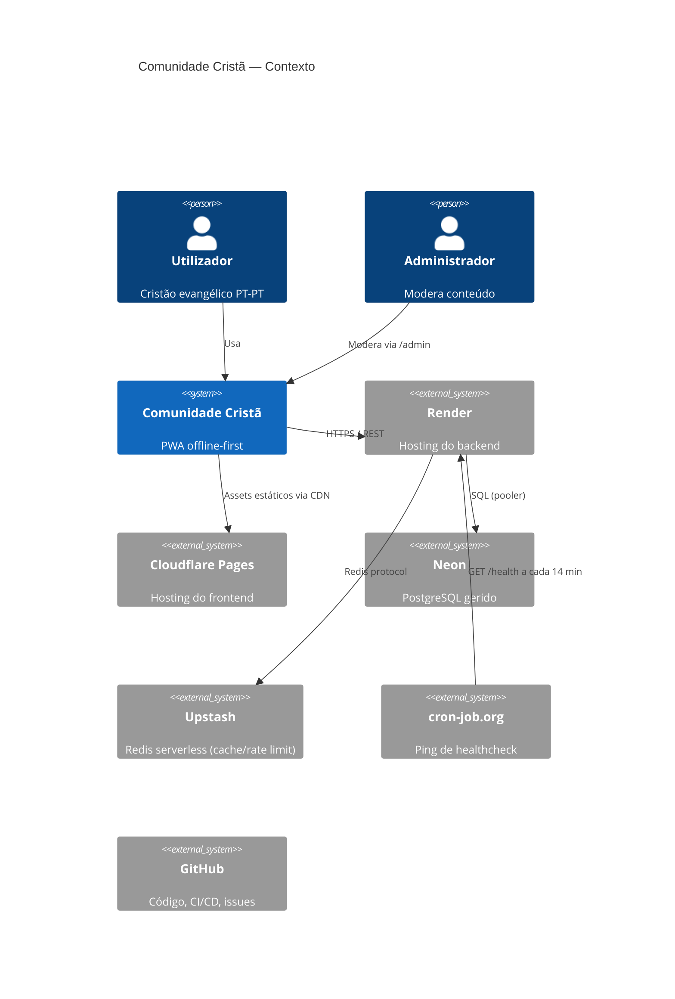
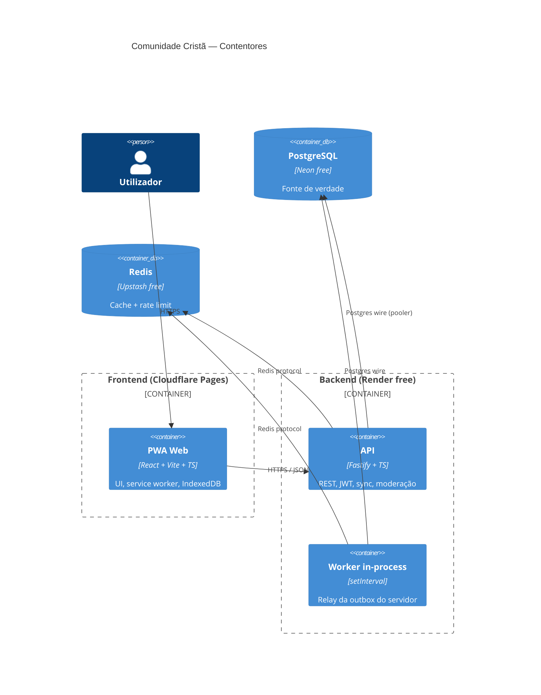
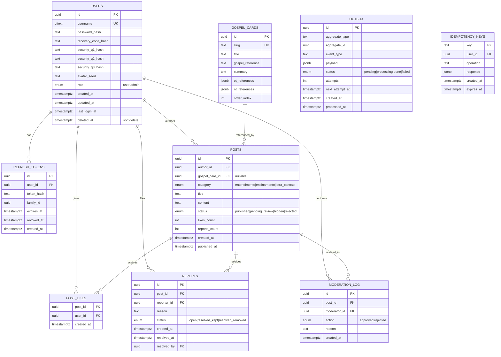
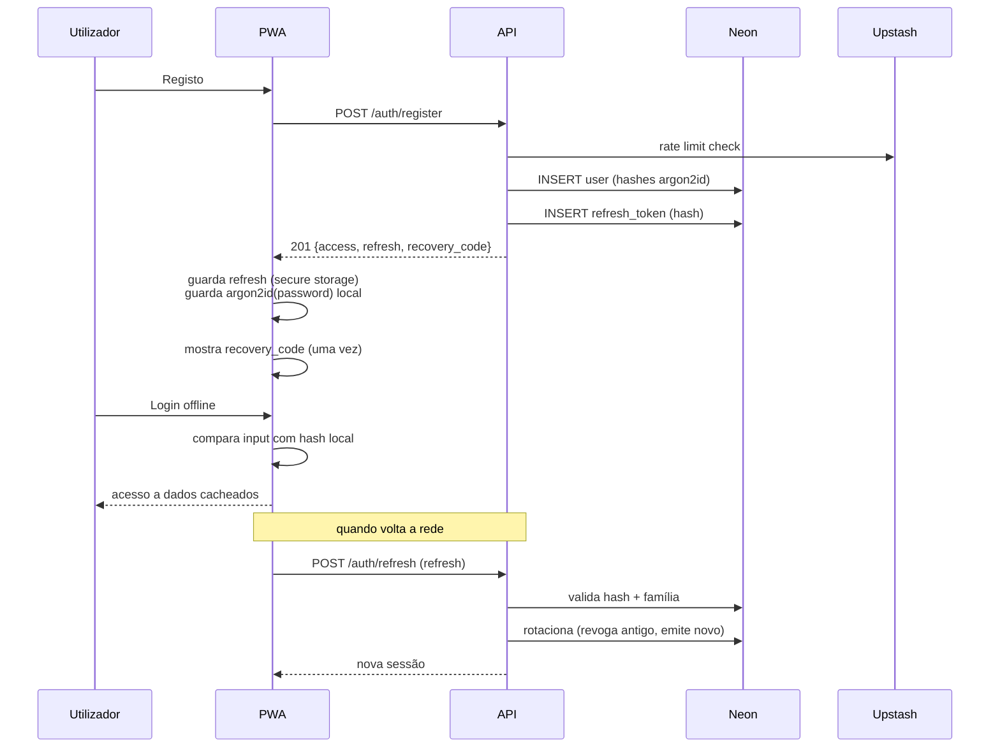
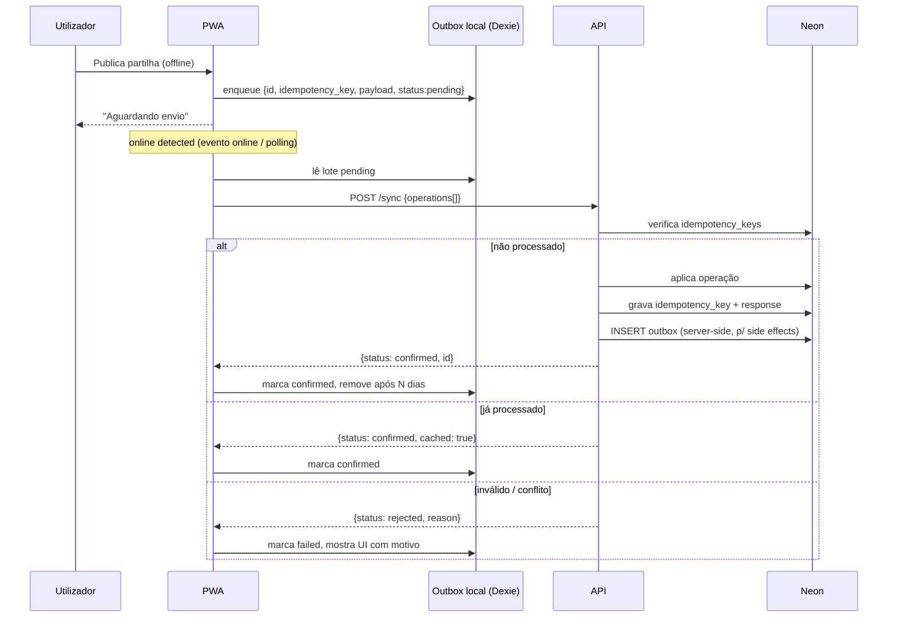
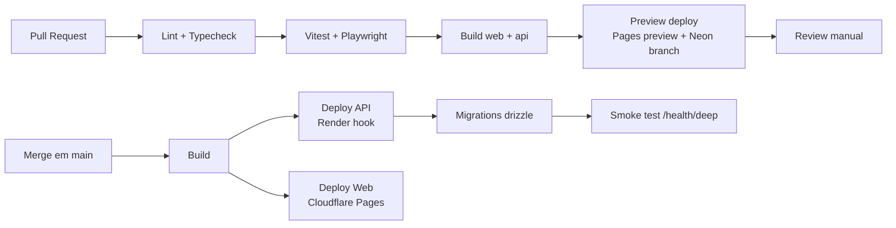

# Documento 2 — Arquitectura

**Versão**: 1.0
**Base**: Briefing 1.0

---

## 1. Contexto (C4 Nível 1)



## 2. Contentores (C4 Nível 2)



## 3. Stack decidida

| Camada                | Escolha                                                           |
| --------------------- | ----------------------------------------------------------------- |
| Frontend              | React 18 + Vite + TypeScript; PWA via `vite-plugin-pwa` (Workbox) |
| Estado / dados locais | TanStack Query + Dexie (IndexedDB)                                |
| UI                    | Tailwind CSS + Radix primitives + Lucide icons                    |
| Backend               | Node 20 + Fastify + TypeScript                                    |
| Base de dados         | PostgreSQL (Neon free) via `pg` + drizzle-orm                     |
| Cache                 | Upstash Redis (`@upstash/redis`)                                  |
| Autenticação          | JWT (EdDSA) + refresh rotativo + argon2id (`@node-rs/argon2`)     |
| Validação             | Zod (partilhado via `packages/shared`)                            |
| Testes                | Vitest (unit) + Playwright (E2E)                                  |
| CI/CD                 | GitHub Actions                                                    |
| Infra local           | Docker Compose (Postgres + Redis)                                 |
| Monorepo              | pnpm workspaces                                                   |
| Licença               | AGPL-3.0                                                          |

### Estrutura do repositório

```
/
├── apps/
│   ├── web/                 # React + Vite + PWA (inclui /admin lazy)
│   └── api/                 # Fastify + TS
├── packages/
│   ├── shared/              # Tipos, schemas Zod, constantes
│   └── config/              # ESLint, Prettier, tsconfig base
├── docs/
│   ├── briefing.md
│   ├── architecture.md
│   ├── runbook.md
│   └── adr/
├── .github/workflows/
├── docker-compose.yml
├── pnpm-workspace.yaml
├── LICENSE
├── CONTRIBUTING.md
├── CODE_OF_CONDUCT.md
└── SECURITY.md
```

O admin vive na mesma app (`apps/web`), em rotas `/admin/*`, carregadas por `React.lazy` e protegidas por role. Reduz superfície operacional no MVP; pode ser separado em `apps/admin` mais tarde se necessário.

## 4. Decisões de arquitectura (ADRs)

### ADR-001 — PWA em vez de app nativa

**Contexto**: distribuição gratuita, código único, offline-first.
**Decisão**: PWA com `vite-plugin-pwa`.
**Consequências**: um único código para web, Android e desktop; instalação sem loja; TWA/APK (bubblewrap) fica para quando houver necessidade real de Play Store; iOS tem limitações conhecidas de push e cache (aceitáveis no MVP).

### ADR-002 — Monorepo com pnpm workspaces

**Contexto**: backend, frontend e tipos partilhados evoluem em conjunto.
**Decisão**: monorepo com `apps/` e `packages/`.
**Consequências**: um só PR pode alterar contrato e consumidor; CI tem de ser eficiente (`pnpm --filter`).

### ADR-003 — Neon em vez de Supabase

**Contexto**: Supabase free pausa após 1 semana de inatividade (bloqueador); Neon free faz scale-to-zero com wake rápido.
**Decisão**: Neon + branch de preview por PR.
**Consequências**: limite de conexões obriga a usar o pooler do Neon e pool pequeno no driver.

### ADR-004 — Upstash Redis apenas para cache e rate limit

**Contexto**: filas críticas não podem depender de um contador mensal de comandos.
**Decisão**: Redis só para cache de leitura e rate limit. Filas (outbox) ficam em Postgres.
**Consequências**: menos carga no Redis; cache com TTL curto; rate limit por IP/username em login e por user em criação de posts.

### ADR-005 — Outbox table em Postgres + worker in-process

**Contexto**: Render free só oferece um web service gratuito; background workers são pagos.
**Decisão**: tabela `outbox` no Postgres, worker a correr dentro do processo Fastify via `setInterval`, com `SELECT ... FOR UPDATE SKIP LOCKED`.
**Consequências**: o worker dorme quando o serviço dorme — eventos internos (notificar admin, purgas, caches) processam-se no próximo wake. Aceitável para o domínio.

### ADR-006 — Autenticação: JWT EdDSA + refresh rotativo + argon2id

**Contexto**: offline-first com privacidade.
**Decisão**: access token EdDSA (15 min); refresh rotativo (30 dias, one-time use, deteção de reuso → revogar família); passwords e respostas de segurança hasheadas com argon2id (params OWASP: m=19456 KiB, t=2, p=1).
**Consequências**: chaves Ed25519 geradas no deploy (env vars); necessidade de rotação documentada no runbook.

### ADR-007 — Offline-first com outbox local + idempotency keys

**Contexto**: rede intermitente e servidor que dorme.
**Decisão**: cliente gera UUID v7 e `idempotency_key` por operação; server deduplica em `idempotency_keys`; retry exponencial no cliente e no servidor.
**Consequências**: contrato `/sync` é crítico — precisa de testes E2E rigorosos.

### ADR-008 — Conteúdo bíblico apenas por referência

**Contexto**: direitos autorais das traduções.
**Decisão**: nenhum texto bíblico integral. Apenas referências e resumo próprio.
**Consequências**: o conteúdo dos cards é curado em `gospel_cards` (seed versionado).

### ADR-009 — Avatar gerado, sem upload

**Contexto**: privacidade, moderação de imagem, custo.
**Decisão**: avatar determinístico a partir do username (iniciais + cor via hash).
**Consequências**: nenhum dado biométrico, nenhuma moderação de imagem, nenhum Cloudinary no MVP.

### ADR-010 — Admin na mesma app, role `admin`

**Contexto**: simplicidade operacional.
**Decisão**: `/admin/*` lazy-loaded, protegido por role `admin` no JWT e por middleware no backend.
**Consequências**: um só deploy; middleware no backend **deve** revalidar role em cada pedido (nunca confiar só no frontend).

### ADR-011 — Recuperação de conta: código imediato, perguntas com atraso

**Contexto**: sem email, a recuperação depende de segredos que o utilizador guarda. O código de
recuperação tem 80 bits de entropia; as perguntas (cor, número 0–999, igreja) têm pouca, e
bastava acertá-las para tomar a conta.
**Decisão**:

- Código de recuperação → efeito imediato. A sessão de recuperação (JWT 5 min) é de **uso único**
  (`jti` em `used_recovery_sessions`) e o reset corre numa só transacção: nova palavra-passe,
  novo código, revogação de todas as sessões e cancelamento de pedidos pendentes.
- Perguntas → a nova palavra-passe fica **pendente** (`pending_password_resets`) durante
  `RECOVERY_QUESTIONS_DELAY_HOURS` (24 h). Não se emite código novo. Se o dono entrar entretanto
  com a palavra-passe actual, o pedido é cancelado e o login devolve `pendingRecoveryCancelled`.
  Passado o prazo, o 1.º login com a nova palavra-passe aplica-a, revoga as sessões e devolve um
  código novo (uma única vez).
- Limites por conta (todos os IPs) e por IP (todas as contas), além de IP+utilizador; sem Redis
  ou com o Redis em baixo, o limite aplica-se em memória (nunca falha em aberto).
  **Consequências**: quem perde o código e não entra durante 24 h perde a conta para quem tiver
  acertado as perguntas — risco aceite sem email. Os atrasos exigem a UI mostrar `recovery_pending`
  e `pendingRecoveryCancelled`.

## 5. Modelo de dados



**Notas**

- UUID v7 em todas as PKs (ordenação temporal sem colisões).
- `citext` para `username` (unicidade case-insensitive).
- Índices: `posts(status, created_at desc)`, `posts(gospel_card_id, status)`, `post_likes(user_id)`, `reports(post_id, status)`, `outbox(status, next_attempt_at)`.
- `outbox` e `idempotency_keys` têm TTL — purga periódica pelo worker (ex.: > 7 dias).
- Purga de conta: `posts.author_id` → NULL (partilha anónima, "[removido]"); `moderation_log.post_id` e `moderator_id` → NULL (a auditoria nunca se perde); `post_likes`, `reports`, `refresh_tokens` e `idempotency_keys` apagam-se em cascata. `idempotency_keys` tem PK `(user_id, key)`: a chave vem do cliente e só é única por utilizador.
- Outbox: `claimBatch` empurra `next_attempt_at` para o futuro (5 min) ao reservar; um evento preso em `processing` só volta a ser reclamável depois desse prazo.
- `pending_password_resets` (1 por utilizador) e `used_recovery_sessions` (jti, purgado ao expirar) suportam a recuperação (ADR-011).

## 6. Contratos de API (resumo)

Base: `/api/v1`. Todas as rotas autenticadas usam `Authorization: Bearer <access>`. Respostas e pedidos validados com Zod (`packages/shared`).

### Autenticação

| Método | Rota                   | Descrição                                                                    |
| ------ | ---------------------- | ---------------------------------------------------------------------------- |
| POST   | `/auth/register`       | Cria conta. Devolve tokens + `recovery_code` (única vez).                    |
| POST   | `/auth/login`          | Devolve tokens. Rate-limited por IP + username.                              |
| POST   | `/auth/refresh`        | Rotativo. Deteta reuso → revoga família.                                     |
| POST   | `/auth/logout`         | Revoga o refresh atual.                                                      |
| GET    | `/auth/me`             | Dados do utilizador autenticado.                                             |
| POST   | `/auth/recover/verify` | Valida código de recuperação **ou** 3 perguntas. Devolve `recovery_session`. |
| POST   | `/auth/recover/reset`  | Usa `recovery_session` para definir nova palavra-passe.                      |

### Conteúdo

| Método | Rota                  | Descrição                                |
| ------ | --------------------- | ---------------------------------------- |
| GET    | `/gospel-cards`       | Lista de cards.                          |
| GET    | `/gospel-cards/:slug` | Detalhe de card.                         |
| GET    | `/posts`              | Feed com `?category=&filter=recent       | top | liked&cursor=`. |
| GET    | `/posts/:id`          | Detalhe.                                 |
| POST   | `/posts`              | Cria partilha. Requer `Idempotency-Key`. |
| DELETE | `/posts/:id`          | Autor apaga.                             |
| POST   | `/posts/:id/like`     | Idempotente.                             |
| DELETE | `/posts/:id/like`     | Idempotente.                             |
| POST   | `/posts/:id/report`   | Uma denúncia por user por post.          |
| DELETE | `/posts/:id/report`   | Cancela denúncia aberta.                 |
| GET    | `/users/me/posts`     | Gestão de partilhas.                     |
| GET    | `/users/me/reports`   | Denúncias do utilizador.                 |
| PATCH  | `/users/me`           | Alterar username.                        |
| POST   | `/users/me/password`  | Alterar palavra-passe (atual + nova).    |

### Sync

| Método | Rota    | Descrição                                                                    |
| ------ | ------- | ---------------------------------------------------------------------------- |
| POST   | `/sync` | Lote de operações idempotentes da outbox local. Devolve estado por operação. |

### Admin

| Método | Rota                                 | Descrição           |
| ------ | ------------------------------------ | ------------------- |
| GET    | `/admin/posts?status=pending_review` | Fila de revisão.    |
| POST   | `/admin/posts/:id/approve`           | Aprova.             |
| POST   | `/admin/posts/:id/reject`            | Rejeita com motivo. |
| GET    | `/admin/reports`                     | Denúncias.          |
| GET    | `/admin/moderation-log`              | Auditoria.          |

### Operação

| Método | Rota           | Descrição                                                        |
| ------ | -------------- | ---------------------------------------------------------------- |
| GET    | `/health`      | Leve — **não** toca em DB nem Redis. Devolve versão e timestamp. |
| GET    | `/health/deep` | Toca em DB e Redis. Usado em CI, não em cron.                    |

## 7. Fluxo de autenticação



**Regras**

- Access 15 min, refresh 30 dias rotativo.
- Reuso de refresh revoga **a família inteira** (o utilizador tem de voltar a autenticar-se com password).
- Recuperação: `recovery_code` (primário) ou 3 perguntas (secundário). Ambos hasheados com argon2id.
- Rate limit em login: 5 tentativas / 15 min por IP+username, 20 / h por conta e 30 / 15 min por IP; login válido repõe o balde IP+username. Recuperação por perguntas: 5 / dia por conta.

## 8. Fluxo de sync offline



**Regras**

- `POST /sync` aceita até 20 operações por chamada.
- Cada operação tem `{op_id, idempotency_key, type, payload}`.
- Retry exponencial no cliente: 5s, 15s, 45s, 2m, 5m, 15m (máx. 6 tentativas); depois estado `failed` visível.
- Servidor **nunca** confia em `created_at` do cliente — usa sempre `now()`.
- Conflito de username ou de exclusão: `rejected` com motivo específico.

## 9. Estratégia de caching

| Chave                               | TTL  | Invalidação                           |
| ----------------------------------- | ---- | ------------------------------------- |
| `feed:{category}:{filter}:{cursor}` | 60s  | Ao publicar/apagar post na categoria  |
| `post:{id}`                         | 120s | Ao editar, apagar, mudar status, like |
| `post:{id}:likes_count`             | 120s | Ao like/unlike (increment atómico)    |
| `cards:list`                        | 1h   | Só em seed de conteúdo                |
| `user:{id}:profile`                 | 60s  | Ao alterar username                   |

**Regras**

- Cache-aside: o backend lê do Redis, em falha vai a Postgres.
- Contadores (`likes_count`, `reports_count`) mantidos em Postgres como fonte de verdade; Redis só acelera leitura.
- Rate limit: `@upstash/ratelimit` (sliding window).

## 10. Estratégia de cold start

- **`/health` leve**: `{status, version, timestamp}` — sem tocar em DB nem Redis. É este que o cron-job.org chama.
- **cron-job.org** a cada **14 minutos**, entre as **06:00 e as 23:00** (hora local dos utilizadores maioritários). Fora desse intervalo, deixar dormir.
- **Frontend**: ao arrancar, mostra UI local imediatamente e faz healthcheck em background com timeout de 3s. Se falhar, banner discreto: _"Servidor a acordar — podes continuar a ler; o envio fica em fila."_
- **Loading de formulário**: mensagens progressivas conforme estado (contactar → tentar acordar → sincronizar) — já definidas no briefing.

## 11. Segurança e privacidade

- **Transporte**: HTTPS obrigatório (Pages + Render oferecem).
- **Cabeçalhos**: HSTS, CSP estrita (self + api), `X-Content-Type-Options`, `Referrer-Policy: no-referrer`.
- **CORS**: apenas o domínio do frontend.
- **Passwords e respostas**: argon2id (m=19456 KiB, t=2, p=1).
- **JWT**: EdDSA (Ed25519); chaves em env vars; rotação documentada.
- **Rate limiting**: login (IP+username), registo (IP), criação de posts (user), denúncias (user).
- **Validação**: Zod em todos os endpoints.
- **SQL**: drizzle-orm com prepared statements; sem concatenação.
- **Logs**: sem passwords, sem tokens, sem PII; username é o único identificador presente.
- **Privacidade**: sem IP persistido, sem analytics de terceiros, sem cookies de rastreio. Política de privacidade e termos de utilização publicados.
- **Apagamento de conta**: soft-delete; purga após 30 dias; posts ficam anonimizados (`author_id = null`, `username = "[removido]"`).
- **Headers de admin**: middlewares separados (`requireAuth`, `requireAdmin`); `/admin/*` revalida role em **cada** pedido.

## 12. Observabilidade

- **Logs estruturados** (pino) para stdout — Render agrega.
- **`/health`** e **`/health/deep`** (deep só em CI e monitorização manual).
- **UptimeRobot** (free) a monitorizar `/health` a cada 5 min — alerta por email em falha.
- **Sem Sentry no MVP** (recolheria dados). Alternativa: tabela `error_log` interna, sem PII, com purga a 7 dias.
- **Métricas mínimas**: contagem de posts publicados, fila de revisão, tamanho da outbox, latência p95.

## 13. CI/CD



**Regras**

- `main` protegida: PR + 1 review + CI verde.
- Migrações: apenas forward; versionadas em `apps/api/drizzle/`.
- `docker-compose` local sobe Postgres + Redis para desenvolvimento e testes E2E.

## 14. Plano de execução por etapas (alto nível)

O plano detalhado será produzido no próximo passo, mas a espinha dorsal é:

| Etapa                                  | Entregáveis                                                                    | Critério de saída                                   |
| -------------------------------------- | ------------------------------------------------------------------------------ | --------------------------------------------------- |
| **E0 — Fundação**                      | Monorepo, CI, docker-compose, ADRs, setup Neon/Upstash/Render/Pages, `/health` | CI verde; `/health` responde em produção            |
| **E1 — Autenticação**                  | Registo, login, refresh, recuperação por código + perguntas, rate limit        | Fluxos completos testados E2E; tokens rotativos     |
| **E2 — Conteúdo + leitura**            | `gospel_cards` seed, ecrãs de leitura, feed público (só leitura), cache        | Utilizador lê offline; cache invalida corretamente  |
| **E3 — Escrita + sync**                | Composer, outbox local, `/sync`, likes, denúncias                              | Publicar offline → sincronizar sem duplicados       |
| **E4 — Moderação + admin**             | `/admin`, fila de revisão, log de auditoria                                    | Admin aprova/rejeita; posts ocultos corretamente    |
| **E5 — Perfil + suporte + contribuir** | Perfil, gestão de posts, FAQ, suporte, contribuir                              | Fluxos completos                                    |
| **E6 — Polimento**                     | Acessibilidade, i18n preparado, runbook, política de privacidade, termos       | Auditoria de acessibilidade; documentos publicados  |
| **E7 — Entrega**                       | Deploy final, backups, monitorização                                           | Smoke tests completos; cron ativo; backups a correr |
